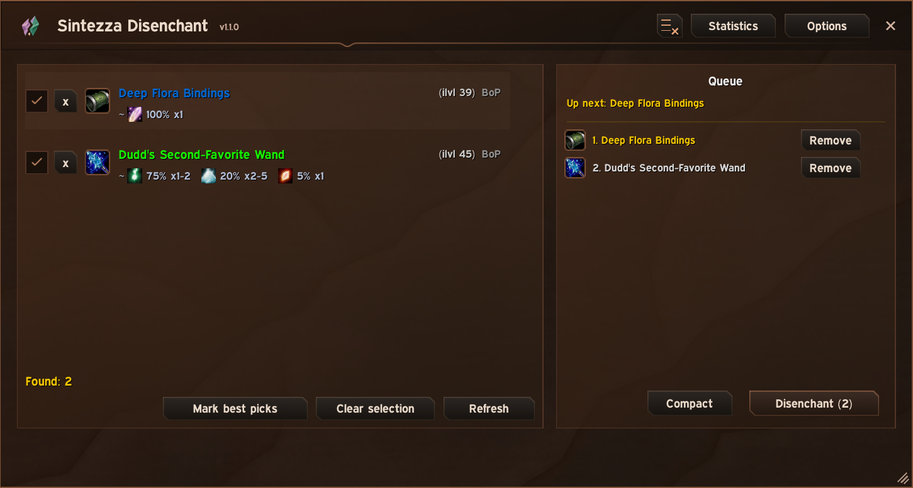
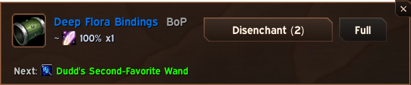
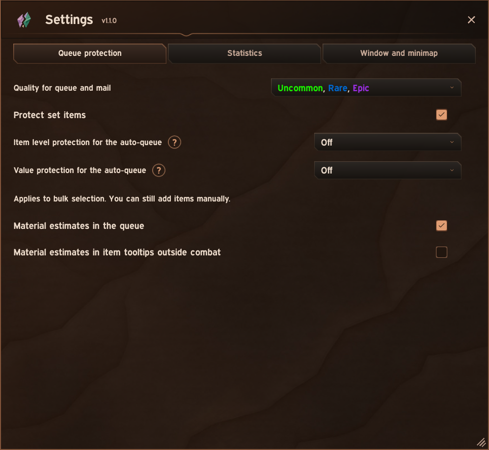
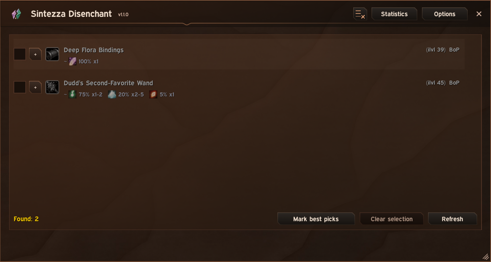
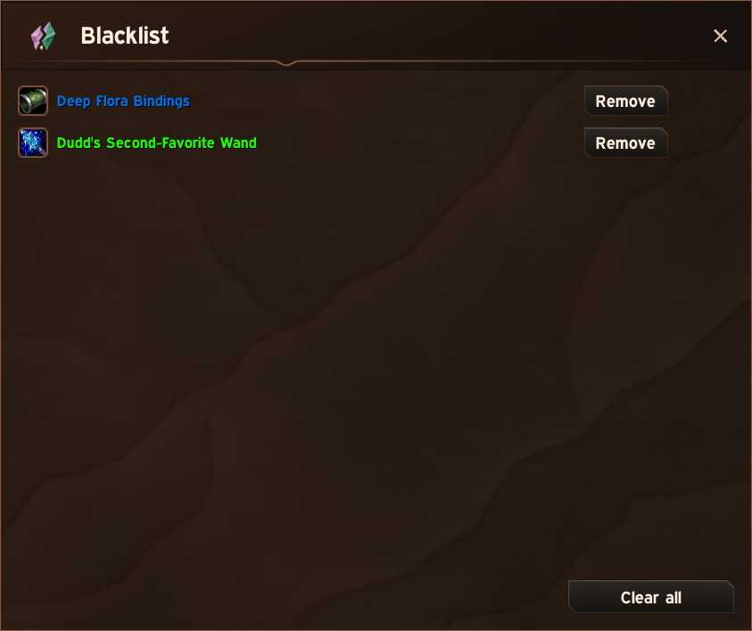
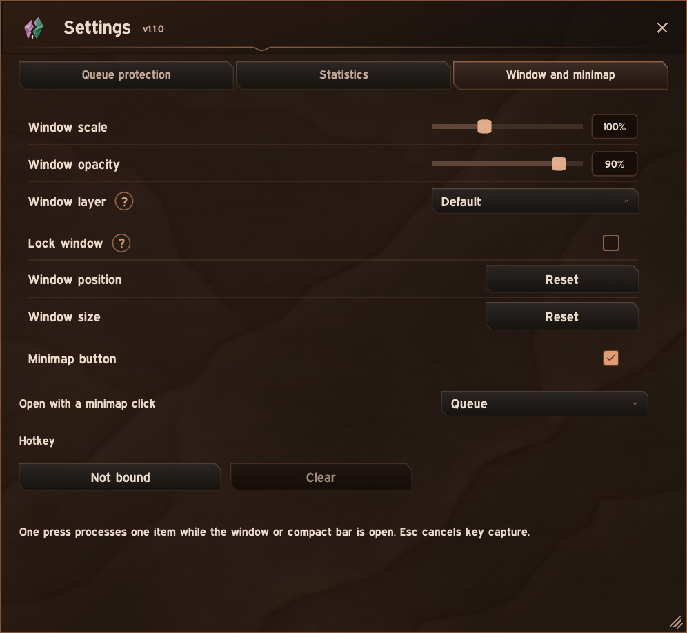

# Sintezza Disenchant

| CurseForge field | Value |
| --- | --- |
| Game | World of Warcraft |
| Class | Addons |
| Flavor and version | Forever 1.60.1 |
| Main category | Enchanting |
| Additional categories | Bags & Inventory, Auction & Economy, Mail, Data Export |
| CurseForge relations | Sintezza Theme (Required Dependency), Mastercraft (Optional Dependency) |
| Project license | MIT. See the repository for third-party notices. |

## Summary

Disenchanting queue, material previews, value comparisons, and result tracking for WoW Forever.

## Description

Queue gear for disenchanting, preview the materials, and track what you recover in WoW Forever. Open `/sde`, click the minimap button, or use the Enchanting profession window.

### Build a disenchanting queue

See what each piece can produce before selecting it. Material previews show the possible results, their chances, and quantity ranges. Process the queue in order, one item per button press.

**Mark best picks** compares estimated material value with vendor and net auction proceeds when prices are available.

### Keep the queue compact

Switch to **Compact** to keep the current item, its material preview, and the next item in a small bar. **Full** takes you back to the complete list.

### Protect gear during bulk selection

Protect equipment sets and choose quality, item-level, and value limits for bulk selection. You can still select items manually.

### Exclude items and restore them

Keep individual items out of the queue until restored. Excluded gear stays visible, so you can see why it cannot be selected.

Review the exclusions together and remove entries when you want those items back in the queue.

To send gear to an enchanter, open the gear-mailing window with `/sde mail`.

### Track disenchanting results

Review session and all-time totals, recovered materials, and their recorded value. Compare estimates with actual results. Manual casts are counted separately. Export or import statistics as CSV.

### Set up your window

Adjust the window size, scale, opacity, and layer. Choose what the minimap button opens and bind a key to process the next queued item while the window or compact bar is open.

### Appearance

**Requires [Sintezza Theme](https://github.com/ArtefactoO/Sintezza_Theme).** Open `/stheme` to change the color scheme, button style, background, and fonts across your Sintezza addons. English and Russian are available.

### Requirements

Your character needs Enchanting and the Disenchant spell. Queueing and result tracking work without a pricing addon.

Install [Mastercraft](https://www.curseforge.com/wow/addons/mastercraft) and enable its loot advice to use its recommendations and prices in **Mark best picks**. [Auctionator](https://www.curseforge.com/wow/addons/auctionator) or [TradeSkillMaster](https://www.curseforge.com/wow/addons/tradeskill-master) can provide fallback market prices. [Baganator](https://www.curseforge.com/wow/addons/baganator) adds an optional queue shortcut.

<!-- Changelog field -->

### Changelog

[View the release history on GitHub](https://github.com/ArtefactoO/Sintezza_Disenchant/blob/main/CHANGELOG.md).

Source, installation details, and credits are available on [GitHub](https://github.com/ArtefactoO/Sintezza_Disenchant).
