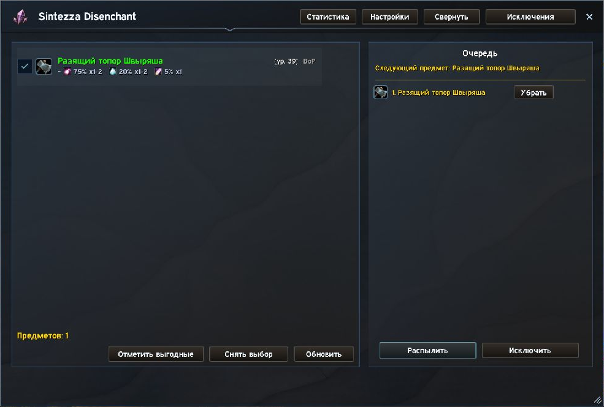
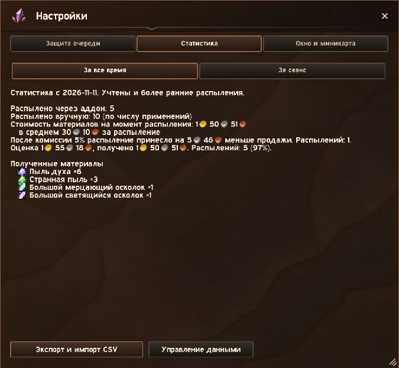

# Sintezza Disenchant

Queue gear for disenchanting, inspect possible materials and their value, and track what you recover in WoW Forever. Each press of the disenchant button processes one item.

**Requires [Sintezza Theme](https://github.com/ArtefactoO/Sintezza_Theme).** The queue and statistics work without a price source. Install [Mastercraft](https://www.curseforge.com/wow/addons/mastercraft) and enable its loot advice to use its recommendations and available prices in **Mark best picks**. [Auctionator](https://www.curseforge.com/wow/addons/auctionator) or [TradeSkillMaster](https://www.curseforge.com/wow/addons/tradeskill-master) (TSM) can supply fallback market prices. [Baganator](https://www.curseforge.com/wow/addons/baganator) can provide a shortcut to the queue. Choose English or Russian in the theme settings.

## Queue and mailing

- Open the queue from the Enchanting profession window, the minimap, Baganator, or `/sde`. Select gear and process the queue one item at a time.
- Protect gear sets, set item-level and price cutoffs, or skip items without a price when adding gear in bulk. You can still select protected gear manually. The separate exclusions list keeps items out of the scan results until restored.
- **Mark best picks** replaces the queue selection with items that return strictly more from disenchanting than from either available sale option. It applies bulk-selection protections and compares net auction proceeds. Mastercraft advice and prices are used first when available. The footer shows when local estimates are needed. Manual selection is available for items with incomplete prices.
- Open the gear-mailing screen from the disenchant icon in the inbox or with `/sde mail` to send gear to an enchanter.

## Results and estimates

The statistics panel counts queued disenchants, records materials reported by the client, and tracks manual casts separately. It can record results without market prices. When a pricing addon has data, Sintezza Disenchant can estimate the value of the materials and share that estimate with Sintezza Vendor.

Export session or all-time statistics as CSV. After validation and confirmation, import replaces the totals for the period described by the file. **Manage data** lets you clear session totals, all-time statistics, and learned results separately.

| Command | Opens |
| --- | --- |
| `/sde` | Gear list and disenchant queue |
| `/sde open` | Disenchant tab in the profession window |
| `/sde mail` | Gear mailing window |
| `/sde options` | Settings |
| `/sde check` | Diagnostics |
| `/sde copy` | Copyable diagnostics report |

## Русский

Sintezza Disenchant собирает из сумок снаряжение для распыления в WoW Forever. Аддон показывает возможные материалы, вероятности и оценку при наличии цен. Одно нажатие распыляет один предмет. **Требуется Sintezza Theme**, в ее настройках выбирается язык.

- Очередь доступна из окна наложения чар, с миникарты и через Baganator при его наличии. Защита массового выбора учитывает комплекты, пороги уровня и цены и правило для предметов без оценки. Защищенные вещи можно отметить вручную, а исключения управляются отдельно.
- «Отметить выгодные» заменяет выбор вещами, которые выгоднее распылить, чем продать торговцу или выставить на аукцион. Аддон учитывает защиту массового выбора и комиссию. При наличии советов и цен Mastercraft они учитываются первыми. При использовании местных оценок появляется пометка «Резервная оценка». Вещи с неполными ценами можно выбрать вручную.
- Значок распыления во входящей почте открывает окно отправки снаряжения персонажу с наложением чар.
- Статистика считает успешные распыления через очередь и записывает материалы, когда клиент сообщает результат. Ручные применения учитываются отдельно. Цены для оценки берутся из Auctionator или TSM, а Sintezza Vendor может использовать готовую оценку распыления.
- На вкладке «Статистика» можно экспортировать итоги сеанса или общие итоги в CSV. Импорт проверяет файл и после подтверждения заменяет итоги указанного в нем периода. «Управление данными» позволяет отдельно очистить итоги сеанса, общую статистику и обученные результаты.

Команды и способы открытия перечислены выше.

## Gallery

## License and code credits

Sintezza Disenchant is available under the [MIT License](LICENSE). Its bag scanning and disenchant queue adapt code from Disenchant Helper by Rokzan, formerly Rakuga. Sintezza adds material statistics, profitable picks, and disenchant estimates for Vendor. [Disenchant Helper](https://www.curseforge.com/wow/addons/disenchant-helper)

[CurseForge listing fields](CURSEFORGE.md)
