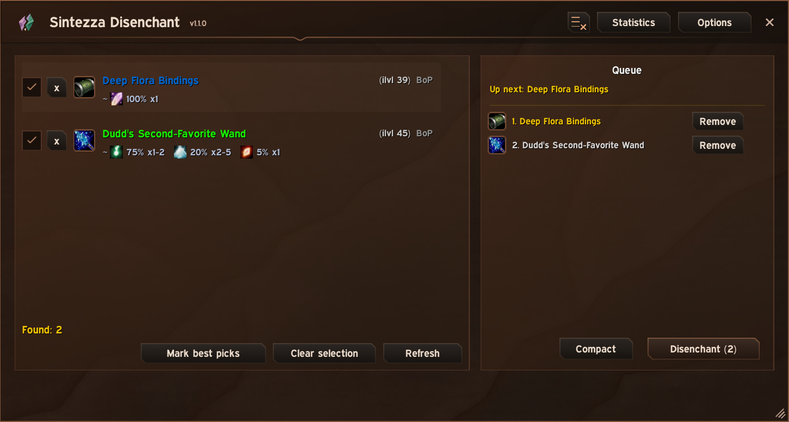
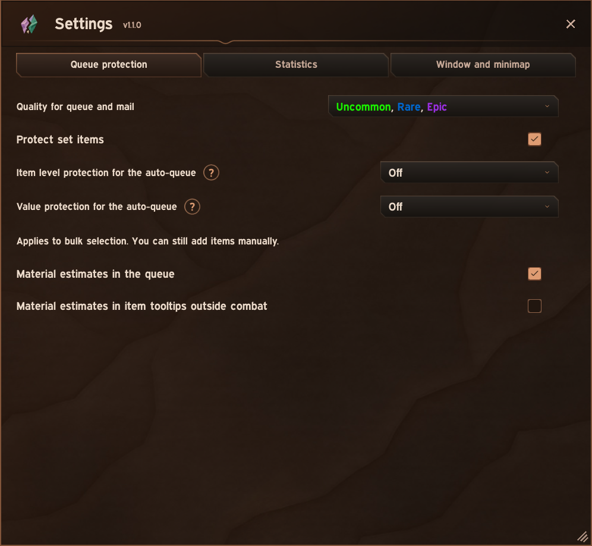
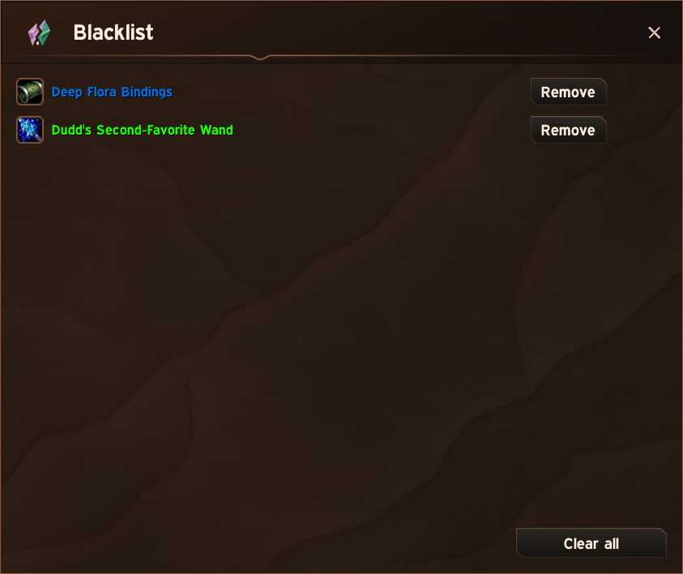
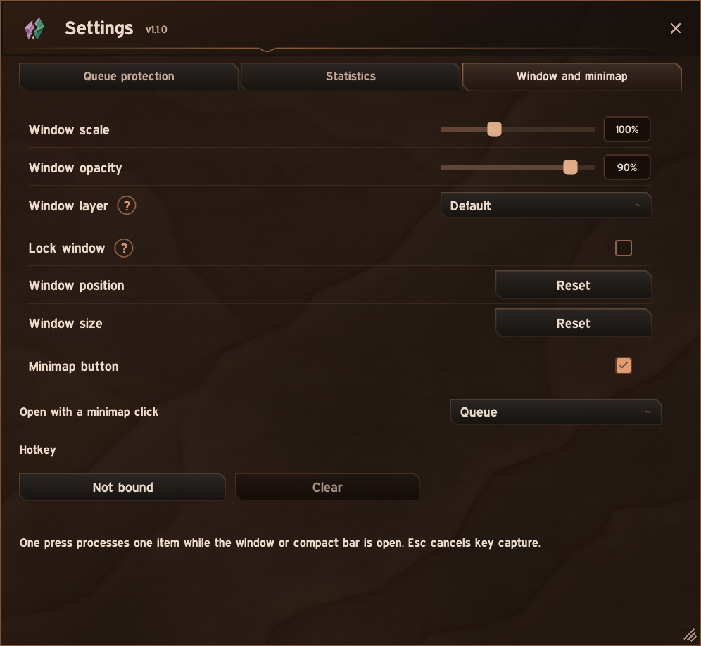

# Sintezza Disenchant

Queue gear for disenchanting, inspect possible materials and their value, and track what you recover in WoW Forever. Each press of the disenchant button processes one item.

**Requires [Sintezza Theme](https://github.com/ArtefactoO/Sintezza_Theme).** The queue and statistics work without a price source. Install [Mastercraft](https://www.curseforge.com/wow/addons/mastercraft) and enable its loot advice to use its recommendations and available prices in **Mark best picks**. [Auctionator](https://www.curseforge.com/wow/addons/auctionator) or [TradeSkillMaster](https://www.curseforge.com/wow/addons/tradeskill-master) (TSM) can supply fallback market prices. [Baganator](https://www.curseforge.com/wow/addons/baganator) can provide a shortcut to the queue. Choose English or Russian in the theme settings.

## Queue and mailing

- Open the queue from the Enchanting profession window, the minimap, Baganator, or `/sde`. Select gear and process the queue one item at a time.
- Switch to **Compact** for a small bar showing the current item, its material preview, and the next item. Use **Full** to return to the complete list.
- The item list and queue fit their visible rows to the window size. Use the mouse wheel or scrollbar to reach the remaining items; selections stay active when their rows are offscreen.
- Protect gear sets, set item-level and price cutoffs, or skip items without a price when adding gear in bulk. You can still select protected gear manually. Use the button beside an item to exclude or restore all copies; excluded items remain visible but cannot enter the queue until restored.
- **Mark best picks** replaces the queue selection with items that return strictly more from disenchanting than from either available sale option. It applies bulk-selection protections and compares net auction proceeds. Mastercraft advice and prices are used first when available. The footer shows when local estimates are needed. Manual selection is available for items with incomplete prices.
- Open the gear-mailing screen from the disenchant icon in the inbox or with `/sde mail` to send gear to an enchanter.
- Set a disenchanting hotkey in **Settings > Window and minimap**. Each press processes one queued item while the window or compact bar is open.

## Results and estimates

The statistics panel counts queued disenchants, records materials reported by the client, and tracks manual casts separately. It can record results without market prices. When a pricing addon has data, Sintezza Disenchant can estimate the value of the materials and share that estimate with Sintezza Vendor.

Export session or all-time statistics as CSV. After validation and confirmation, import replaces the totals for the period described by the file. **Manage data** lets you clear session totals, all-time statistics, and learned results separately.

| Command | Opens |
| --- | --- |
| `/sde` | Gear list and disenchant queue |
| `/sde open` | Disenchant tab in the profession window |
| `/sde mail` | Gear mailing window |
| `/sde options` | Settings |
| `/sde check` | Diagnostics |
| `/sde copy` | Copyable diagnostics report |

## Gallery

**Disenchanting queue.** Preview materials and chances, select gear, and process items in order.

**Compact queue.** Keep the current item's materials, the next item, and the remaining count in a small bar.

**Queue protection.** Configure bulk-selection rules in a standalone settings window.

**Excluded gear.** Items stay visible and dimmed until restored with the per-item button.

**Item exclusions.** Review exclusions in their own window and remove individual entries or clear the list.

**Window and hotkey.** Show the standalone Window and minimap tab, including the disenchanting key.

## Credits and license

Inspired by [Disenchant Helper](https://www.curseforge.com/wow/addons/disenchant-helper) by Rokzan (formerly Rakuga). [MIT License and code credits](LICENSE).

[CurseForge listing fields](CURSEFORGE.md)
